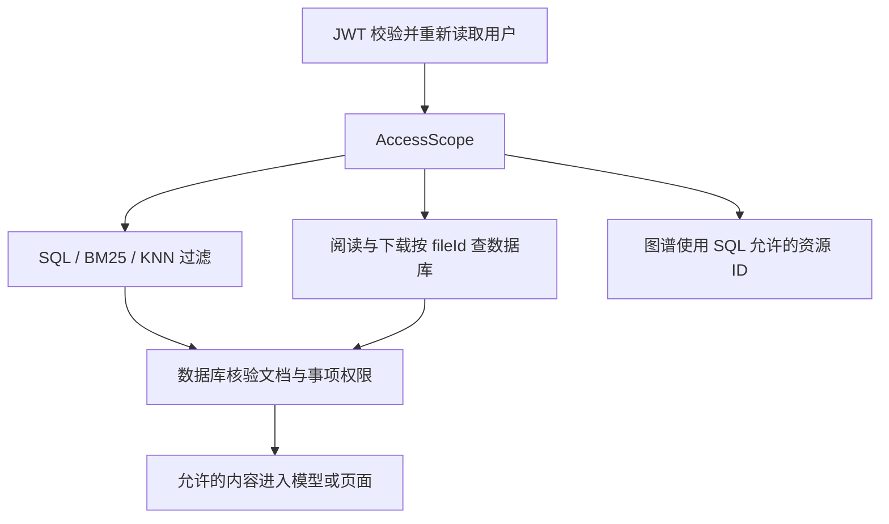

# 文档级权限隔离设计与修复

日期：2026-10-15

## 目标与边界

| 身份 | 知识内容读取范围 |
| --- | --- |
| admin | 所有部门及公共库 |
| 普通用户 | 本部门及公共库 |
| 无部门普通用户 | 仅公共库 |
| 未认证或停用用户 | 拒绝访问 |

权限粒度为整份文档。切片继承文档的 deptName/isPublic，不做段落级授权。管理员的全库读取不扩展为他人个人会话的读写权限。导入、用户管理等已有 admin 操作限制保留。

## 权限来源与兼容策略

`AccessScope.of(User)` 只接受服务端认证后的用户身份。`PermissionService` 使用 PostgreSQL 中的 Item/Document 作为权限依据；ES 与 Neo4j 只是检索投影。

本次沿用已有 deptName/isPublic 字段，不迁移表结构。Document 使用自身部门/公共属性；有关联 Item 时普通用户还必须有权访问 Item。正常导入使二者归属一致；历史不一致记录按两者权限交集处理，避免扩大访问范围。admin 可读取所有现存资源。签阅记录继承所属 Item 的权限。

缺失记录拒绝读取；缺失或空白用户部门只允许公共资源；未知文档公共标志不按公共处理。前端提交的部门、history、文件路径不能用于扩大权限。

## 请求流程

### 1. 混合搜索

`ElasticsearchService.hybridSearch` 接收 AccessScope。普通用户条件为 `isPublic=true OR deptName=当前部门`，显式要求至少一个条件命中；admin 使用 match_all。BM25 与 KNN.filter 使用同一组权限及已有分类/年度过滤条件。

Search/Chat 在拼接上下文之前调用 `PermissionService.filterSearchResults`，批量查询 SQL，去掉不存在或无权访问的文档。来源文件名、部门及路径回填自数据库。索引滞后可能造成少返回，但不会因该索引的过期可见性标签扩大 SQL 允许范围。

### 2. 文本和文件访问

Browse 的文本读取和原文下载都先调用 requireDocument，成功后才读 MinIO。未授权抛出 AccessDeniedException，由现有全局处理器返回 HTTP 403。

Search/Chat 返回已有 `/api/browse/download/{fileId}` 路径，不再签发新的 MinIO 直达链接。前端现有下载逻辑已通过带 JWT 的 HTTP 客户端调用该接口，无需改动。

过去已经签发的 MinIO 链接在有效期内仍可能有效；本次不修改存储凭据或已有聊天数据，也不声明立即撤销这些旧链接。

### 3. 问答结构化上下文

ItemRepository 的标题搜索增加 admin/部门/公共条件。仅为这些允许的事项查询签阅记录。与文档片段一起进入模型前，权限过滤已完成。

### 4. 图谱

概览使用数据库当前允许的 Item ID 集合限制 Cypher；文档节点及计数也限制到可读 Document ID 集合。详情先 requireItem，再展开该事项的文档、签阅和签阅人，文档仍按可读 ID 过滤。这样不能通过直接传 itemId 绕过概览限制，图谱中旧的权限标签也不能单独放行资源。

当前实现传递 ID 集合，适合现有规模；大规模图谱需分页或批次查询优化，不应通过移除授权条件解决性能问题。

### 5. 缓存

本次停用 search、browseTree、graphOverview 的结果缓存，所有内容请求实时鉴权；已有 Redis 条目不再读取，不需要在线清空数据库。importTasks 等无关缓存保留。

选择停用是因为目前没有跨 SQL/ES/Neo4j 的统一权限版本及失效事件机制。仅增加角色缓存键仍无法解决资源撤权后的旧结果命中。后续恢复缓存必须同时包含范围标识、完整查询参数和权限版本，并可靠处理授权及导入变更失效。

### 6. 会话写入

ConversationService 的读取、追加、重命名和删除统一校验所有者；addMessage 必须传 userId。Chat 在任何消息写入及模型调用前校验会话所有者，历史从数据库加载最近 20 条，不采信请求体 history。

个人历史保留现有所有者可读策略。调部门或撤权后历史回答不会自动擦除，历史也可能包含以前合法获取的内容。若业务要求追溯撤销已生成答案，需要进一步存储每条回答的完整资源依赖（含结构化事项）并制定历史重审策略；此项不属于本次七个现存入口漏洞的修复。

### 7. 导入归属

文档候选查询限定 deptName/isPublic。先匹配同一范围的文件名主体，再对 expected 记录做兼容模糊匹配；多个候选拒绝处理，避免随机取第一条。新原文件对象路径包含 fileId，降低同名文件相互覆盖风险。

CSV 导入已有 Item/File ID 时，必须归属相同范围；关联事项与签阅目标也必须同范围。跨部门的相同原始 ID 暂时报错，沿用现有全局主键结构，不擅自迁移为复合主键。权限变更不得通过普通重导隐式完成。

## 验证与交付

使用 mock 验证 ES 请求过滤、权限服务、下载前拒绝、图谱越权拒绝、会话写入前拒绝、无缓存入口、同名导入范围；使用 H2 内存数据库验证结构化查询和 CSV 归属约束。测试不连接业务 PostgreSQL、Redis、ES、Neo4j、MinIO 或模型服务。

2026-10-15 验证结果：`mvn -o -f backend/pom.xml test`，40 项测试通过，0 失败、0 错误、0 跳过；`git diff --check` 通过。Windows 沙箱内 Mockito 的 Java attach 管道被拒绝，获准在沙箱外执行后测试正常完成。

为运行回归测试，同时修正了原有 JPA 切片误加载应用启动器和 H2 引号类型配置；原有“不支持格式”测试使用已支持的 TXT 文件，已改为真正的未知扩展名并断言包装异常原因，另补 TXT 正常解析测试。未修改解析器的业务行为。

上线前仍需在隔离测试环境验证真实 ES 的 BM25/KNN、Neo4j 的 Cypher 及前端下载。现有历史错误归属需要另行只读核查；如需修正数据、迁移或重建索引，先获取数据库修改授权并备份。

本次不执行部署或数据库修正。部署代码前后均应保留可回滚版本；回滚到旧版本会恢复已知权限缺口，不能作为常规权限故障解决方式。
