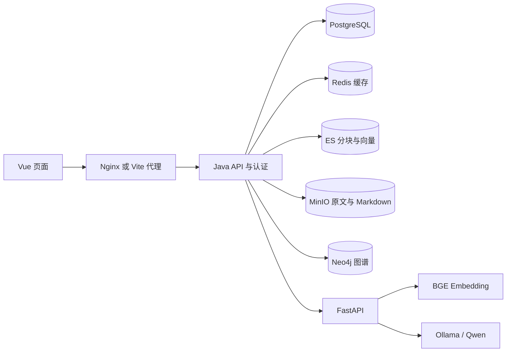
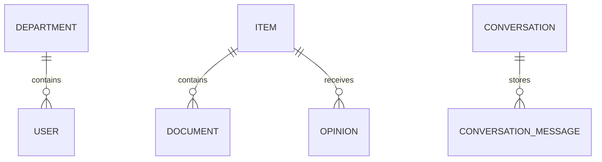
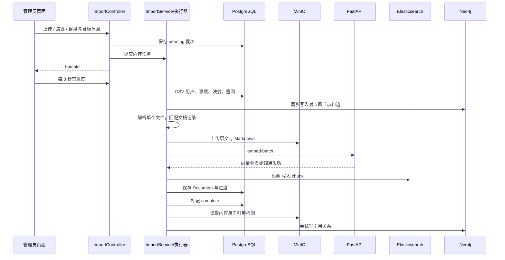
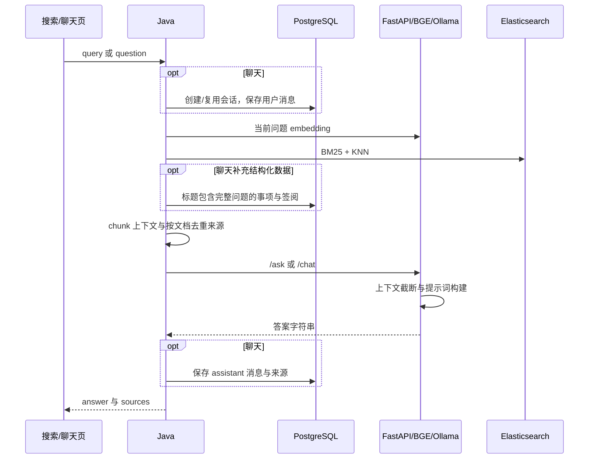

# 当前架构与协作链路

## 1. 模块职责

| 模块/组件 | 当前职责 | 关键入口与协作对象 |
|---|---|---|
| Vue 前端 | 登录、聊天、综合搜索、目录浏览、图谱、管理员导入与管理 | `src/api/index.ts` 为请求附加 JWT；路由守卫控制入口显示 |
| Spring Security | 验证 JWT，加载现有用户，按角色保护管理 API | `JwtAuthFilter`、`SecurityConfig`；资源级权限另由业务代码负责 |
| 导入编排 | 扫描/解压、CSV、解析、存储、向量和索引、引用检测 | `ImportService`；首次任务送入 `importExecutor` |
| CSV 导入 | 创建事项、文件映射、签阅、用户/部门；同步调用图写入 | `CsvImportService`；PostgreSQL 与 Neo4j 两份数据 |
| 文档解析 | DOC/DOCX/WPS/OFD/TXT 文本提取，PDF 原生提取/OCR 回退，生成 Markdown | `DocumentParser`、`PdfParser`、共享 Tesseract Bean |
| PostgreSQL | 用户/部门、事项/签阅、文件关联、批次进度、会话消息 | JPA entity/repository；当前最接近业务事实来源 |
| MinIO | 原始文件与 Markdown，两种 bucket | `MinioService`；原文键为部门/文件名，Markdown 键为文件 ID |
| Python AI 服务 | BGE embedding；构造提示词并通过 Ollama 生成答案 | `/embed`、`/embed-batch`、`/ask`、`/chat` |
| Elasticsearch | 保存分块及向量；BM25 与顶层 KNN 混合检索 | `ElasticsearchService`；1024 维向量、IK 分词 |
| Neo4j | 部门/事项/文档/签阅/用户关系，分类编号引用 | `GraphBuildService` 写；`GraphController` 读 |
| Redis | 搜索结果、目录树、图谱概览缓存 | `CacheConfig`；搜索 10 分钟、目录 30 分钟、图谱 15 分钟 |
| Nginx/启动与部署 | 代理、静态资源、进程/容器启动 | 宿主机脚本与完整 Compose 是两套部署路径 |

当前 Java 后端是业务协调中心，Python 是推理适配层。Redis 没有承担导入队列，Neo4j 没有参与当前检索或问答生成，Ollama 在完整 Compose 中仍依赖宿主机。

## 2. 业务模型与身份

图是逻辑关系；`ConversationMessage.conversationId` 当前是普通数值列，没有通过 JPA 关系建立外键。事项/文档的部门范围以字符串 `deptName` 与 `isPublic` 表达，用户则通过部门实体关联。名称并非统一稳定 ID，因此未来部门改名/合并也需要明确同步规则。

当前身份约定：

| 身份 | 来源/用途 | 协作缺口 |
|---|---|---|
| `itemId` | CSV 事项主键、图 Item 主键 | 没有注明不同来源系统的 ID 命名空间 |
| `fileId` / `docId` | CSV 文件 ID 或 UUID；SQL、ES、Markdown、图关联 | 全库文件名匹配会跨范围选择记录 |
| `batchId` | 每次导入生成 UUID | Document 只有一个 importBatch，不能表达多批次处理历史 |
| `chunkIndex` | 顺序分块；ES ID 为 fileId_chunkIndex | 没有内容版本、页码或字符位置 |
| `Opinion.id` | SQL 自增 | 图 Opinion 使用 CREATE，缺统一业务 ID |
| `conversationId` | SQL 会话 ID | 追加消息未校验归属 |

## 3. 导入链路

三个首次入口最终使用单线程执行器（队列容量 10），每批文件顺序执行。这能控制初次导入资源争抢，但重试走同步 HTTP 方法，未复用执行器。

CSV 识别约定是固定文件名前缀：user → item → file_index → item_with_opinions；每个类型最多选一个文件。目录扫描用 `putIfAbsent`，压缩包扫描用 `put`，同类多文件取舍不同；尚无统一清单和预检报告。

正常文档处理在匹配后上传两个对象，再分块、过滤、向量化和 ES bulk。最多保留 100 块。非空向量列表被视为 embedding 成功，未核对数量/维度；ES 单项错误仅写日志。Document 的 matched/orphan 是关联状态，实际上同时被拿来推断处理是否完成，两种语义混在一起。

CSV 方法有数据库事务，但图写入不属于同一提交；图服务捕获异常。对象上传、embedding、ES 写入与 Document 保存也没有跨存储原子提交。普通首次导入靠仓库调用的小事务，重试方法则包裹整个长流程，失败时可能出现两条路径表现不同。

Spring 的普通事务绑定执行线程，不会自动传播到新线程；代理事务也要求调用经过代理。优化时不能给编排方法简单加注解就认为所有组件一起提交。[Spring 事务说明](https://docs.spring.io/spring-framework/reference/data-access/transaction/declarative/tx-decl-explained.html)、[事务注解说明](https://docs.spring.io/spring-framework/reference/data-access/transaction/declarative/annotations.html)。

## 4. 搜索与问答链路

搜索接口还缓存整体答案与来源；聊天不使用这个答案缓存。查询 embedding 失败会返回空数组，ES 转成纯 BM25。生成失败也被 AIClient 转成普通文本，无法与正常回答明确区分。

当前 query + knn 按 ES 8.15 的并集和评分合并工作，代码的“RRF”注释没有对应实现。两个分支必须分别执行同样的权限/筛选条件。[ES 8.15 混合 KNN 文档](https://www.elastic.co/guide/en/elasticsearch/reference/8.15/knn-search.html)。

聊天补充结构化签阅是独立的 SQL 标题 LIKE 搜索，没有用召回文件的 itemId 反查。用户自然语言问题未必是标题子串，因此文档能召回、签阅却可能补不上。历史由浏览器提供，只在生成时加入，当前问题检索不会利用历史消解“它”等指代。

## 5. 浏览、图谱与管理链路

- 浏览树读 SQL Item，再逐事项查 Document；正文读 MinIO Markdown。没有事项关联的 orphan 文档不进入这棵树，即便 ES 已可检索。
- 下载通过 Java 代理原始对象；搜索/聊天响应同时生成 MinIO 预签名链接。当前页面按钮实际使用代理下载。
- 图谱概览读 Department→Item→Document；详情读某个 Item 的 Document/Opinion/User。虽然导入写了 REFERENCES，详情查询没有返回引用关系。
- 图谱搜索复用综合 RAG 搜索，把 SourceDoc.fileId 放到结果 id；选择结果后却使用图谱 itemId 接口。
- 用户/部门管理直接使用 SQL 仓库，未走 CSV 的图同步路径。同样的业务对象经不同入口写入，最终结果可能不同。

## 6. 已有值得保留的机制

单线程导入和批量 embedding/ES 能限制初次处理资源；PDF 按页异常隔离避免一页失败拖垮整份文档；图节点 MERGE 和基础唯一约束已提供部分去重；会话读取/删除/重命名有所有权校验；基础角色保护与前端统一 API 层已存在。优化应补齐这些机制的边界，并把所有入口纳入相同规则。

## 7. 代码导航

| 链路 | 代码 |
|---|---|
| 导入与恢复 | [ImportService](../../backend/src/main/java/com/knowledge/service/ImportService.java)、[ImportController](../../backend/src/main/java/com/knowledge/controller/ImportController.java)、[AsyncConfig](../../backend/src/main/java/com/knowledge/config/AsyncConfig.java) |
| CSV 与解析 | [CsvImportService](../../backend/src/main/java/com/knowledge/service/CsvImportService.java)、[DocumentParser](../../backend/src/main/java/com/knowledge/service/DocumentParser.java)、[PdfParser](../../backend/src/main/java/com/knowledge/service/PdfParser.java) |
| 检索与生成 | [ElasticsearchService](../../backend/src/main/java/com/knowledge/service/ElasticsearchService.java)、[AIClient](../../backend/src/main/java/com/knowledge/service/AIClient.java)、[Python main](../../ai-service/main.py) |
| 会话、浏览、图 | [ConversationService](../../backend/src/main/java/com/knowledge/service/ConversationService.java)、[BrowseController](../../backend/src/main/java/com/knowledge/controller/BrowseController.java)、[GraphBuildService](../../backend/src/main/java/com/knowledge/service/GraphBuildService.java)、[GraphController](../../backend/src/main/java/com/knowledge/controller/GraphController.java) |
| 前端与部署 | [API 层](../../frontend/src/api/index.ts)、[完整 Compose](../../docker/docker-compose.yml)、[宿主机启动](../../start.sh)、[宿主机部署](../../deploy.sh) |
