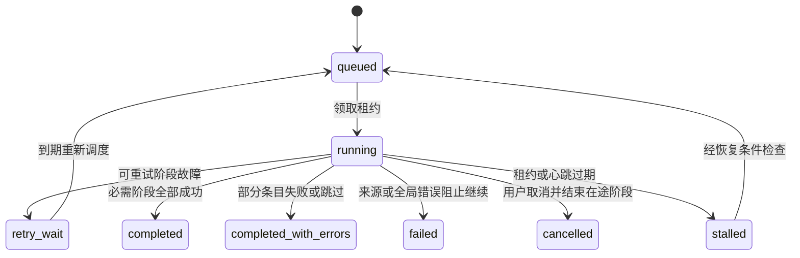
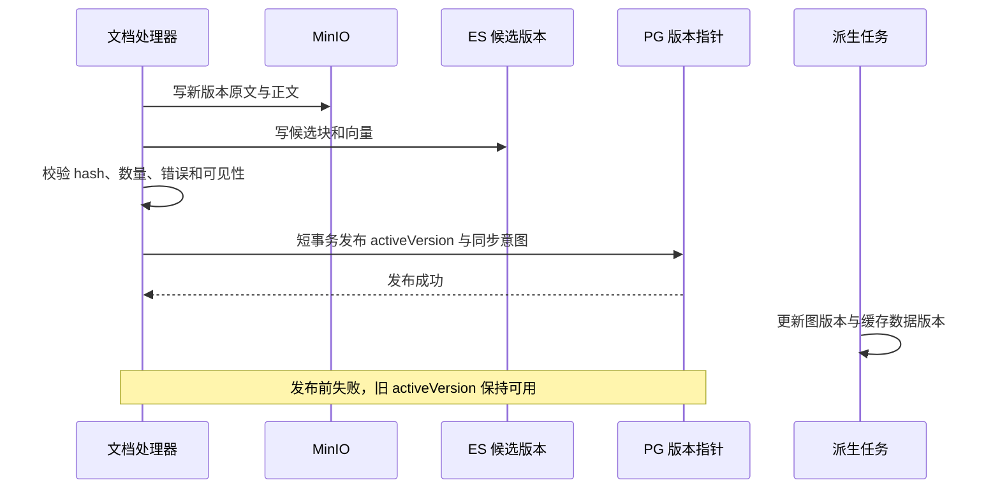

# 目标协作设计与接口契约

本文为拟议设计，所有新增字段、服务与接口均尚未实现。保留 Java 业务核心、Python 推理服务及现有存储，先补统一规则，不要求拆成更多微服务或引入消息中间件。

## 1. 六条共同规则

1. PostgreSQL 保存业务主数据、授权范围、内容版本、任务状态与派生同步意图；MinIO 保存不可变版本对象。
2. ES 和 Neo4j 是有版本的派生视图；它们失败不能抹掉已接纳的业务记录，也不能假报同步成功。
3. 文档身份与部门/来源范围明确；匹配状态、处理状态和发布状态各自独立。
4. 外部 I/O 不进入长数据库事务；每个阶段短提交、可重试、幂等、可对账。
5. 权限过滤、缓存键、下载、模型上下文使用同一服务端范围；禁止客户端扩大权限。
6. 任务成功、检索降级、资料不足、模型失败具有不同的机器可读状态。

## 2. 模块边界与职责

| 建议模块 | 拥有的规则 | 不由它承担的工作 |
|---|---|---|
| AccessPolicyService | 授权范围、资源读取/写入、会话归属、scopeFingerprint | 前端按钮可见性不是授权依据 |
| ImportApplicationService | 预检、接纳任务、持久清单、幂等提交、重试接纳 | 不在 HTTP 中跑完整解析 |
| ImportTaskRunner | 租约领取、阶段推进、心跳、取消、汇总 | 不直接定义各格式解析细节 |
| MetadataService / DocumentIdentityResolver | CSV upsert、待关联补偿、范围内匹配、歧义报告 | 不以全库文件名自动换归属 |
| DocumentProcessingService | 解析质量、分块、候选版本、发布前校验 | 不把关联状态当处理完成 |
| ObjectStoreGateway / EmbeddingGateway / SearchProjectionWriter | 外部调用与结构化结果 | 不吞失败成普通成功 |
| GraphProjectionService / ReferenceExtractionService | 稳定 ID、版本化节点边、引用来源、补偿 | 图写失败不决定 SQL 回滚 |
| RetrievalService / ContextAssembler / AnswerService | 统一检索条件、证据、预算、生成与引用校验 | 图谱导航不调用答案生成 |
| ConversationApplicationService | 授权历史、turn 去重、消息状态与顺序 | 不相信客户端任意历史 |
| CapabilityHealthService / ReconciliationService | 能力状态、对账差异、待补偿任务 | 只读诊断不暗中修数据 |

这些可先是同一个 Spring Boot 项目内的类/包边界。Controller 负责 DTO 验证与响应，核心编排下沉到可测试服务；Python 聚焦模型调用和容量管理。

## 3. 身份与数据契约

### 3.1 文档和来源

建议字段/记录：

| 对象 | 建议关键字段 | 用途 |
|---|---|---|
| Document | docId、scopeId、sourceNamespace、externalFileId、itemId、matchState、activeVersion、permissionVersion | 稳定业务身份及发布指针 |
| DocumentVersion | docId、version、contentHash、原文/正文对象描述、parserVersion、chunkerVersion、embeddingModelId、vectorDimensions、chunkCount、processState | 一份不可变内容与处理规则 |
| ImportManifestEntry | entryId、batchId、sourceType、sourceRelativePath、sourceHash、docId、candidateVersion、stageStates、attempt、errorCode | 恢复清单，不靠文件名猜进度 |
| PendingAssociation | sourceNamespace、externalItemId/externalFileId、scopeId、associationType、state | 不受 CSV 到达顺序限制 |
| Opinion | opinionId、externalOpinionId/经确认指纹、itemId、sourceNamespace、scopeId | SQL 与图共享身份 |
| ProjectionJob / Outbox | eventId、aggregateId、aggregateVersion、projectionType、state、attempt、nextAttemptAt、leaseOwner、leaseUntil、fencingToken | 持久可靠同步 |

若现有 CSV ID 经证明全局唯一，可以继续作内部主键；否则先引入来源复合唯一约束/内部 ID 映射。不能未经调查整体替换主键。scopeId 优先稳定部门 ID，公共区单独表示；deptName 作为显示字段。

文件匹配优先级：同范围外部 ID → 同范围规范化相对路径 → 同范围唯一内容指纹候选 → 人工消歧。hash 相同不自动表示同一业务事项，更不能跨权限范围合并。

MinIO 对象描述包含 bucket、key、hash、size、version，不让同一个 String 同时代表原文与 Markdown。建议对象键 `documents/{docId}/{version}/original` 与 `documents/{docId}/{version}/content.md`；历史固定键仍保留兼容读取，迁移后验证再清理。

### 3.2 状态分离

`matchState`：expected、matched、orphan、ambiguous；它只回答“是否与业务映射关联”。

`processState`：received、parsed、stored、embedded、indexed、ready、retry_wait、failed、unsearchable；具体阶段状态单独记录，不强迫所有恢复从 received 开始。

`publishState`：candidate、active、retired；失败候选不能成为 active。

`graphState` / `referenceState`：pending、processing、ready、retry_wait、failed；明确版本和更新时间。



当前字段 status 长度 20；`completed_with_errors` 为 21 字符，新枚举落库前必须扩容或选短码，不能只改 Java/前端。取消至少检查在途阶段边界；删除任务记录只限终态，不等于删除业务数据或恢复文件。

### 3.3 完成条件

每个批次从固定清单统计 `total = succeeded + failed + skipped + remaining`，一个条目是一个逻辑输入，CSV 条目内部另外统计行数。进度为已终结条目占比；100% 可以有失败，但必须显示 completed_with_errors。

- 对可检索文档，成功要求：原文/正文对象核对、合法分块、向量数量/维度匹配、ES 全部目标块写入成功且按发布策略可见、主库版本发布成功。
- 无有效正文或部分解析失败按明确质量政策处理，不能一律当可检索成功；保留原文可浏览能力，显示 unsearchable 或警告。
- 仅元数据批次也可成功，不强迫不存在的文档阶段。
- 业务默认允许图谱异步滞后，返回 graphState/referenceState。若某类批次要求完整图谱，则把该阶段明确设为必需；不将“所有组件完成”和“文档可检索”用同一模糊状态表达。

## 4. 可靠任务与局部恢复

### 4.1 接纳与执行

1. 验证范围、格式、路径、大小、磁盘与 idempotencyKey；文件来源持久化或记录可验证的不可变清单。
2. 用短 PG 事务创建批次、清单与 runnable job。来源准备失败返回失败，不留下永久 pending；对象准备后 DB 提交失败留下候选对象，由保留期内的对账清理识别。
3. 返回 202 + batchId + statusUrl；轮询不依赖 HTTP 请求继续存活。
4. Runner 在短事务领取 job，登记租约/心跳/执行 token；网络/OCR/推理在事务外执行。
5. 阶段完成后短事务保存结果与下一阶段意图；失败分类后有限退避，最终仍失败则进入可见 failed 状态。
6. 重启扫描无主/过期租约，按清单和对象 hash 恢复；不能将其他实例仍活动的任务直接标失败。

租约仅控制执行所有权，不保证旧 worker 已停止。每次更新必须比较 fencingToken 与版本；外部写入只写候选版本键/索引，迟到 worker 不能覆盖 active 版本或发布指针。

第一阶段保留单 worker，数据库持久队列足够；没有必要立即上 Kafka。Redis 当前使用 allkeys-lru，不能把可靠任务记录仅放到可能被驱逐的缓存中。

### 4.2 Outbox 与补偿

主数据更新和派生同步意图在同一 PG 事务提交；独立消费者执行 ES、图、缓存版本更新。崩溃后的未确认任务可重新投递，因此所有消费者必须幂等。纯内存 after-commit 事件能调整提交时机，但不能代替持久任务恢复。

图消费者按稳定对象 ID 和版本写节点，并替换该对象受管的关系集，保留不属于它的关系；删除/归属变化产生 tombstone/关系替换事件。没有版本的 MERGE 只能防同键重复，不能自动纠正旧关系。

失败处理采用“保留事实、补偿派生”：图停机不反复重导 CSV，ES 某块失败只重试该候选版本失败块，对象缺失从可验证来源重传。恢复器只读生成差异报告，补偿执行需获得相应写入允许。

## 5. 文档版本发布



PG 指针与 ES 标志无法跨组件原子切换。过渡实现应在 ES 候选返回后批量核对 PG 的 activeVersion/权限，只把匹配版本交给用户和模型，并在剔除过期候选后有限补取。必须测试新旧版本重叠、短暂空窗和分页；只过滤 SQL 最后一步也不能修复 KNN 候选阶段授权缺失。

规模增长后可以独立版本索引加 alias 切换，用于全量重建/模型升级；仍要保留回滚和主库版本验证。不要声称 alias 能同时提交 PG/MinIO/Neo4j。

记录 modelId/版本/维度、归一化方式、query/document 编码策略和分块版本；不同 embedding 模型即使维度相同也不能混为同一向量空间。模型迁移建新候选索引，评测后切换，旧索引按批准的保留政策处理。

## 6. 统一检索、图谱与证据

### 6.1 API 分工

| 建议接口 | 职责 | 返回核心内容 |
|---|---|---|
| `POST /api/retrieval` | 纯召回，可选择 BM25/向量/显式融合 | evidence、normalizedFilters、degradation、dataVersion |
| `GET /api/items/search` | 图谱/浏览查事项，避免调用 LLM | itemId、title、scope、documentCount |
| `GET /api/graph?itemId=...` | 授权后的事项子图 | 节点/边、graphVersion、syncState |
| `POST /api/chat` | 授权会话中的单个 turn | turnId、状态、答案、引用、召回证据 |
| `GET /api/browse/doc/{fileId}` | 授权正文阅读 | documentVersion、content、quality、processState |
| `GET /api/browse/download/{fileId}` | 当前授权范围内下载 | 正确对象版本的文件流 |

保留旧 `/search` 作为组合接口适配层，内部使用 RetrievalService + AnswerService，逐步迁移前端。

统一 SearchFilter 包含 category、year、itemType、sourceScope、topK；规范化后用于 SQL/ES 两分支和缓存。年度按业务定义选择 string 或 validated integer，同一次升级必须处理历史数据。ES 文档明确包含 itemId、year、itemType、docVersion、permissionVersion。

BM25/向量检索先独立过滤；采用 RRF 时用明确两路排名合并，去重键按 docId/version/chunkId。综合得分阈值、重排和 chunk 数由样本评测决定，不能把任意 topK 当成有效证据。

### 6.2 证据契约

```json
{
  "evidenceId": "doc-42:v3:c7",
  "resourceType": "document_chunk",
  "docId": "doc-42",
  "itemId": "item-9",
  "version": 3,
  "chunkId": "c7",
  "fileName": "关于信息安全的通知.pdf",
  "pageStart": 4,
  "pageEnd": 5,
  "charStart": 1600,
  "charEnd": 2050,
  "text": "示例正文",
  "quality": "native"
}
```

页码未知时返回 null，不制造页码。事项/签阅用各自 resourceType 与稳定 evidenceId；来源卡片按文档聚合，但不改变底层引用标识。保存引用 ID 和版本，浏览时重新鉴权；下载链接按需短期签发，不能把历史消息中保存的七天 URL 作为长期定位或权限依据。

生成只接受服务端授权证据集；返回 usedEvidenceIds 和 answerStatus，服务端检查 ID 均来自本轮。对自由文本答案的事实正确性仍需评测；引用 ID 检查只能保证来源归属，不能保证每句得到证据支持。

## 7. 会话、错误与前端协作

聊天请求使用 conversationId + clientRequestId，先验证会话所有权，再短事务创建 user message 与 pending turn。生成期间不持有 DB 事务；完成/失败按 turnId 保存。相同 clientRequestId 重试返回同一 turn，避免因前端超时重复写入。

历史从服务端消息构建，按 user/assistant 成对与总 token 预算处理；权限变化后不得继续把旧的未授权引用/内容送入模型。必要时失效旧摘要或限制受影响会话的继续生成。追问先形成独立检索问题，保留改写版本及原问。

响应兼容 ApiResponse，但逐步规范 HTTP 状态：400 无效输入、403 无权、409 状态冲突、429 容量不足、503 能力暂不可用、504 deadline。示例：

```json
{
  "code": 200,
  "message": "已返回检索证据，生成暂不可用",
  "data": {
    "requestId": "req-1",
    "status": "degraded",
    "degradation": ["LLM_UNAVAILABLE"],
    "answer": null,
    "evidence": [],
    "retryable": true
  }
}
```

示例仅说明字段形状；真实降级若有召回，evidence 必须保留。无文档与 ES 停机是不同状态。失败不保存为普通 assistant 成功消息，也不缓存成正常答案。

前端按 turnId/conversationId/selectionId 归属处理返回；旧响应写回其自己的会话状态或被丢弃。轮询绑定具体批次，用单次请求结束后再调度的方式避免重叠，断网退避/卸载清理；图表 dispose 并移除监听。页面展示排队、当前阶段、最后心跳、成功/失败数与可恢复操作，不只显示转圈。

## 8. 缓存、容量与 deadline

缓存键结构：`cacheSchemaVersion + scopeFingerprint + permissionVersion + normalizedQuery/FilterHash + dataVersion + model/promptVersion`。目录与图必须区分角色范围；答案缓存还要包括所有决定生成的配置。仅缓存非敏感能力允许的结果，读取缓存仍检查当前授权，资源链接使用时重新签发。

数据发布成功后可靠更新相应版本：SQL 树、ES 检索、图谱各自有可见性版本。公共内容更新会影响全部可见公共区的范围，不能只清某个部门。Redis 异常时缓存层可失败开放为直接读取，但不能跳过权限或伪造成功；限制旁路并发防止击穿主库。

容量建议先保持导入并发 1；在线 embedding 与导入批量设独立受限队列并保留在线配额。推理移出事件循环，模型实例资源不随意复制。队列满明确 429/503 和 Retry-After，健康探测使用独立短预算。

timeout 是每次等待上限，deadline 是整次业务的截止时间。示例预算仅用于实现讨论，须压测校准：交互总预算 90 秒，embedding 8 秒、ES/SQL 5 秒、生成最多 70 秒，其余用于网络与持久化；网关/浏览器期限留高于服务端预算的余量。上传独立于推理预算，导入阶段每次重试受阶段限额与批次总期限约束。重试只在剩余预算足够且操作幂等时进行。

## 9. 能力健康与发布约束

| 依赖故障 | 默认业务表现 |
|---|---|
| PG 不可用 | 依赖身份/主数据/会话的 API 不就绪，禁止继续发布 |
| MinIO 不可用 | 导入存储阶段重试；下载/正文明确不可用；不伪装 404 |
| ES 不可用 | 检索明确失败；已接纳内容留待索引；不直接用无授权证据生成 |
| Embedding 不可用 | 查询显式 BM25 降级；新文档向量阶段等待恢复 |
| Ollama 不可用 | 返回授权的检索证据与生成失败状态，其他浏览能力继续 |
| Neo4j 不可用 | 图谱降级，派生同步待重试；文档检索不被图写入拖住 |
| Redis 不可用 | 有界旁路读主系统，记录降级与限流 |

liveness 只反映进程是否可继续工作；readiness/能力探测验证业务所需依赖、bucket、索引 schema、模型 ID/维度和 OCR 资源。每个检查返回 status/latencyMs/checkedAt/errorCode，受单项及总预算限制。公开健康只给必要信息，详细检查需运维授权。

生产配置必须明确凭证、模型、持久目录、允许输入根目录与资源限额；关闭隐式 ddl-auto:update，改为经允许且有备份的版本迁移。部署前校验 JAR/前端构建版本与镜像匹配，不能用端口出现替代就绪。脚本和 Compose 共用可核对的配置表，确定一条主部署路径。
