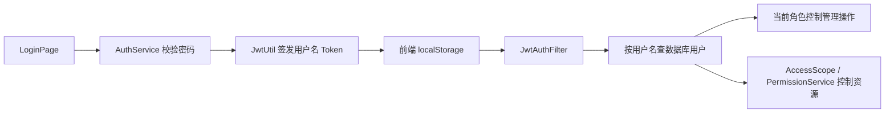

# 基于实际项目的鉴权完善方案

调查日期：2026-10-16；代码基线：`3faef99`。项目尚在开发、未开始部署；本方案不设计旧 Token、旧接口或历史数据兼容。仅调查和设计，未改业务代码、未启动服务、未修改数据库。本次不处理 AI 网关。

实施更新：用户已授权按本方案完成第一批代码，具体交付、配置和验证见 [07 鉴权第一批实施记录](07-auth-implementation.md)。下文现状表保留调查时的基线。

## 1. 现有需求决定的边界

[原始需求](../../doc/需求.md) 要求本地知识库、不同部门、部门文档/公共文档、admin/普通用户，以及 user.csv 创建用户/部门。当前代码中未发现接入外部统一登录、第三方授权、SSO 或多个应用共享认证的既有需求。

当前是一个 Vue 应用和一个 Spring Boot 业务后端，Python 服务负责推理。认证应继续集中在 Java 后端，资源授权继续由 Java 业务服务执行。现阶段采用现有 Spring Security + JWT + AccessScope/PermissionService 即可，不新增独立认证中心，不自行实现 OAuth/OIDC 协议。

## 2. 已核对的实际链路

| 环节 | 当前事实 | 直接影响 |
|---|---|---|
| 登录 | AuthService 查用户名并 BCrypt 校验；没有 enabled 判断；直接取 department.name | 停用用户仍能得到 Token，但随后请求被过滤器拒绝；无部门用户登录可能异常 |
| Token | sub=username，附带 role/dept，7 天过期；validate 与 getUsername 分别解析 | 同名账号重建可能继承旧凭证；角色/部门 claims 没用于最终授权，形成多余信息源 |
| 请求认证 | 每次按用户名查现有用户，检查 enabled，取当前角色写入 SecurityContext | 已经能采用最新账号状态和角色，无需为这一点重写认证体系 |
| 资源授权 | SQL 权威校验 Document/Item，ES 两分支过滤、图资源 ID 过滤、会话所有者校验 | 已有核心授权模块，继续复用；不要恢复仅依赖前端或 Token 部门的判断 |
| 认证 API | AuthController 只有 POST /login | 没有身份恢复接口、密码修改、服务端退出等生命周期能力 |
| 用户管理 | API/页面主要是列表、新增、删除；enabled 字段存在但无停用管理接口；无角色/部门修改接口 | 不能把未来管理能力当作已经存在的需求，先补现有规则 |
| 用户输出 | UserController 列表/新增直接返回含 password 的实体 | 响应包含密码 hash；admin 才可访问也不需要输出 hash |
| 初始化 | DataInitializer 空库自动建固定密码管理员并记日志；另有公开 /users/init | 两套入口和条件竞争；缺少一个明确可控的初始化流程 |
| 管理约束 | UserPage 禁止删除 admin 按钮，后端 deleteById 没有相同规则；role 输入无白名单 | UI 和服务端规则不一致，直接调 API 可以绕过按钮限制 |
| 登录状态 | Pinia 从 localStorage 恢复；token 非空即 isLoggedIn，角色来自保存的 user | Token 过期仍先进入页面；菜单可能与当前账号状态不一致 |
| 登录失效 | 401 清本地存储并 window.location 跳登录；登录成功固定 /search | 不保留原页面；并发失败可能多次处理；登录失败与登录失效也共用这一逻辑 |
| 退出 | 只清浏览器 Token 和用户信息，无后端退出接口 | 是本机退出，不是已签发 Token 撤销，不能声称退出后所有副本立即失效 |
| 登录限流 | 注解 5 次/60 秒；内存计数，无过期清理，直接采信转发 IP 头 | 长期积累计数；非可信代理来的 IP 头可能绕过限制 |
| 测试 | 有资源权限/导入范围测试；未发现 JwtUtil/JwtAuthFilter/AuthService 专项完整链路测试 | 既有资源权限测试不能代替登录和账号身份生命周期验证 |

代码依据：[AuthService](../../backend/src/main/java/com/knowledge/service/AuthService.java)、[JwtUtil](../../backend/src/main/java/com/knowledge/security/JwtUtil.java)、[JwtAuthFilter](../../backend/src/main/java/com/knowledge/security/JwtAuthFilter.java)、[UserController](../../backend/src/main/java/com/knowledge/controller/UserController.java)、[DataInitializer](../../backend/src/main/java/com/knowledge/config/DataInitializer.java)、[前端状态](../../frontend/src/stores/auth.ts)、[请求层](../../frontend/src/api/index.ts)、[路由](../../frontend/src/router/index.ts)、[登录限流](../../backend/src/main/java/com/knowledge/security/RateLimitInterceptor.java)。

## 3. 第一批：补齐当前业务，不增加表或认证服务

### 3.1 稳定身份与单一权限来源

- Token sub 改为 User.id，严格解析正整数并按 findById 查当前用户；旧 username Token 不兼容。开发环境删除账号后不得重置序列并复用 ID；重建数据库/重置身份时使开发凭证失效，必要时更换开发签名密钥。
- Token 保留身份、签发/到期时间等必要字段，角色/部门取现有用户记录。不要允许 Token 中的旧角色或客户端 user 信息成为授权依据。
- 校验签名/有效期并只解析一次，非法 subject/不存在/停用账号都产生可控 401，不变成 500。
- 登录自身检查 enabled；部门为空时按“普通用户只能公共区”一致处理，避免登录阶段与 AccessScope 规则矛盾。新建账号是否必须选部门可继续保留输入约束。
- 保留现有 SecurityFilterChain 和资源权限服务；不为了形式增加无实际职责的认证框架封装。

### 3.2 安全且一致的账号管理

- 引入 UserResponse/CurrentUserResponse，含 id、username、role、department、enabled；不返回 password/hash。使用验证 DTO，role 只允许 admin/default，用户名/密码/分页有明确限制。
- 第一批先落实页面现有的“管理员不可直接删除”到服务端；以后如要允许删除/降级管理员，再定义保留最后一名可用管理员的规则，并处理并发。不能只依赖页面禁用按钮。
- 保留 BCrypt；API 和 CSV 创建账号共用校验与编码规则。同名已存在时 CSV 应明确提示跳过/冲突，不能图中更新了角色而 SQL 没更新。
- 初始化只保留一个受控入口：建议首次启动显式提供 bootstrap 管理员配置，缺配置时明确给出配置指引；已有账号则不重复创建。不保留公网无凭证 init，不硬编码或记录明文密码。开发快捷配置也应显式启用。
- JWT 密钥由开发配置提供，弱/缺失配置提前报错；CORS 按实际开发前端来源配置。当前 Bearer Authorization 模式不要求顺便切 Cookie；若以后切 Cookie，再同步设计 CSRF。

### 3.3 前端登录状态真正与后端协调

- 新增 GET /api/auth/me，返回当前认证用户的安全 DTO，不签发新 Token。
- 有本地 Token 时，在首次访问受保护页面前调用 me；状态区分尚未确认、已登录、未登录。身份确认完成前不凭旧 role 展示管理入口。
- me 返回 401 才清登录状态；网络断开/服务端故障显示可重试错误，不能误当用户已退出。前端角色只用于交互，服务端仍负责强制授权。
- 统一 expireSession/logoutLocal 逻辑，Pinia 与持久存储同时清理；并发 401 只处理一次。当前登录请求的 401 显示错误，不能再次执行“会话过期跳登录”。
- 保存站内原路由，登录后返回原页面；避免开放重定向。无权限显示 403，不当成 Token 失效。localStorage JSON 损坏也能安全恢复为未登录。
- 第一批保留本机退出语义，明确它不会撤销其他副本 Token。Token 有效期应按使用体验确定，不把任意缩短时间当作撤销机制。
- 修正限流的计数过期/容量和可信代理来源；单实例开发不要求新增 Redis 限流服务。

## 4. authVersion 和 OAuth 何时才需要

当前没有修改密码、强制退出全部设备或停用后重新启用的管理功能。第一批修复“同名账号重建”只需稳定用户 ID，不需要 authVersion。

当增加密码修改/管理员重置、全部设备退出、停用后恢复仍必须重新登录等功能时，需要凭证失效机制。届时 authVersion 是一个可选的简单实现：Token 携带版本，每次查用户时比较，相关操作递增版本。若只检查 enabled，重新启用后未过期旧 Token 会恢复可用，必须明确这一点。

单设备退出需要按 Token/会话记录撤销，authVersion 只能粗粒度让账号全部 Token 失效。没有单设备管理需求就不增加 session 表、jti 黑名单和刷新 Token 轮换。

只有实际需要单位统一身份源、跨系统登录或第三方接入时，再考虑 OIDC/OAuth。接入身份服务后，部门/文档/事项/会话授权仍由本项目负责。现阶段既不部署认证中心，也不自研协议服务器。

Spring Security 的 SecurityContext/Authentication 已能承载当前身份和授权信息，本项目现有做法可以在此基础上完善。[官方认证架构](https://docs.spring.io/spring-security/reference/servlet/authentication/architecture.html)。此处仅引用稳定的架构概念，不要求升级当前依赖。

## 5. 最小接口和代码职责

| 位置 | 第一批目标 |
|---|---|
| AuthController/AuthService | login + me；密码及账号可用性校验；安全响应 |
| JwtUtil/JwtAuthFilter | 用户 ID Token、一次解析、当前账号校验、统一 401 |
| UserController/账号服务 | 校验 DTO、用户安全输出、管理约束；服务只在共用规则需要时抽取 |
| CsvImportService/DataInitializer | 复用账号创建规则，受控初始化，禁止密码日志 |
| AccessScope/PermissionService | 保留当前部门/公共区及会话授权边界 |
| Pinia/API/router/LoginPage | 身份恢复、错误分流、一次失效处理、站内返回路径 |

无需第一批增加 /refresh、/sessions、OAuth 登录和多种授权模式。也不把前端 XSS 修复混入身份协议改造；安全渲染仍是单独必须修复的事项，本机存储 Token 时尤其需要覆盖。

## 6. 验证与实施边界

需要补充的测试：删除重建同名账号后旧 Token 拒绝；非法/到期 Token 401；停用账号登录即拒绝；当前角色/部门生效；所有用户 DTO 无 password；管理员删除 API 与页面一致；me 成功/401/断网三种结果；并发 401 一次处理；站内跳转与损坏存储恢复；CSV/API 创建规则一致。

第一批可以在不新增数据库字段的前提下准备代码，但账号创建、删除、初始化等实际操作仍是数据库写入。不得用“开发环境”推定允许操作数据库；执行写入/修改/删除前仍须获得允许并按项目约束备份。测试采用隔离 mock/内存环境，避免启动完整应用触发业务库初始化或 ddl-auto 更新。

第一批代码现已实施；未来 authVersion/OAuth 等可选能力仍未实施，详见上述实施记录。
